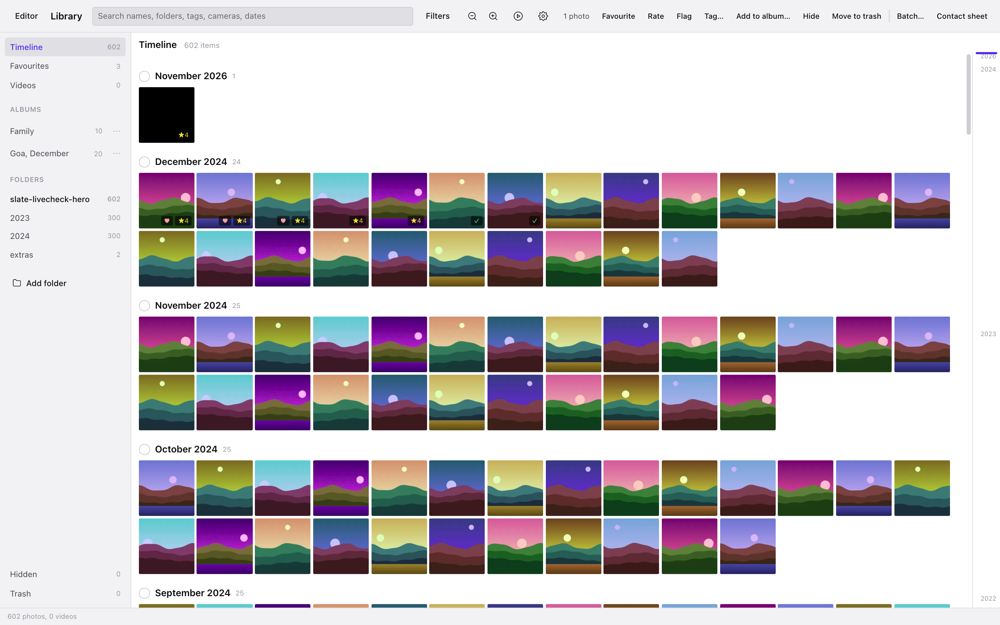

<h1 align="center">Slate</h1>

<p align="center"><b>An image editor and photo library in one HTML file: open a photo to crop, redact and adjust it, or point Slate at your photo folders and browse, find and cull them as one timeline.</b></p>

<p align="center">Slate runs in the browser. Your photos stay in your folders. There is no account, no server and no upload.</p>

<p align="center">
  
  
  
  
</p>

<p align="center"></p>

## Install

| Where | How |
|---|---|
| Any browser | Open [slate.naklitechie.com](https://slate.naklitechie.com/) |
| NakliOS | Open Slate from the [naklios.dev](https://naklios.dev/) desktop |
| Offline | Save `index.html` to disk and open it |

Drop an image on the page to edit it. To build a library, press **Ctrl+L** (or the Library button), then **Add folder** and pick the folder that holds your photos. Slate reads the folder and its subfolders, shows the timeline within a second, and fills in thumbnails while you browse. Everything Slate decides about a photo (favourites, ratings, flags, tags, albums) goes into one file, `.slate-library.json`, in that folder. There is nothing to configure. To try it without your own photos, open any folder of sample images.

## Why

You have photos in folders on your own disk, and every photo app wants to copy them into its own store or its own cloud first. Slate leaves them where they are and builds its index beside them, so you can delete the index at any time and rebuild it from the folder.

Slate is two tools in one page. The editor handles a single image: crop, redact, blur, pixelate, annotate, rotate and straighten, adjust in linear light, apply a `.cube` look, resize and sharpen. It reads JPG, PNG, WebP, GIF, AVIF, SVG, BMP, HEIC, TIFF, JPEG XL, PSD, TGA, DDS and RAW (through the embedded preview), and writes PNG, JPEG, WebP and TIFF. The Library handles tens of thousands of photos: a timeline by date, albums, favourites, star ratings, pick and reject, tags, hidden, trash, search, folders and a full-size viewer that also plays videos. Editing in the browser cannot write HEIC or RAW back, so Slate saves those as new files instead.

Chrome and Edge get the full Library. Firefox and Safari cannot write to a picked folder, so there the Library is browse-only and keeps its choices in the browser, with a button to download the library file.

## Culling a shoot

Open the Library, click the first photo, then use the keys: **0** to **5** rate, **P** picks, **X** rejects, **F** favourites, **H** hides, **Delete** moves to the trash. Hold **Shift** with any of them to apply it and move to the next photo. Every change shows an Undo button. The trash is a `.slate-trash` folder inside your photo folder, so nothing is lost until you choose Empty trash.

## Where your data lives

| What | Where |
|---|---|
| Your photos | Your folders, never moved or changed by the Library |
| Favourites, ratings, flags, tags, albums | `.slate-library.json` in each folder you add |
| XMP sidecars (`photo.jpg.xmp`) | Read when present; tags and ratings from Lightroom and digiKam show up |
| The index and thumbnails | Browser storage (IndexedDB and OPFS); Rebuild index recreates them |
| Edits | Saved as new files; Export can embed the edit list so Slate can reuse it |

## Commands

```text
Ctrl+L            open or close the Library
/                 search: names, folders, tags, albums, cameras, years, months
Arrows, Enter     move through the grid, open the viewer
E                 open the photo in the editor; Escape returns to the Library
0-5  P X U  F H T rate, pick, reject, unflag, favourite, hide, tag
Shift + any key   apply, then move to the next photo
Delete            move to the trash (restore from the Trash view)
Ctrl+S            save; Ctrl+Shift+V applies edits copied from Image Info
?                 help, with every shortcut and the licences
```

Agents use the same actions. `commands.json` lists 26 commands (`library.search`, `photo.rate`, `album.add` and the rest). Inside NakliOS, Slate registers them, and the host asks you before any destructive one runs.

## Verify it yourself

```bash
npm test                                              # builds index.html, runs 9 test files
python3 -m http.server 8493 --bind 127.0.0.1          # then, with the CDP daemon on 127.0.0.1:9334:
node scripts/live-check.mjs --count 10000             # Library: 44 checks on 10,000 synthetic photos
node scripts/live-check-colour.mjs                    # Adjust and LUT on the WebGPU path
node scripts/live-check-recipe.mjs                    # edit list embedded in exports
```

The tests check the index, the library file round trip, the scanner, the grid maths, the commands against the NakliOS rules, the licence notices and the colour maths. The live checks drive the built page in Chrome with real mouse and key events on synthetic photo folders and delete those folders afterwards. They do not cover HEIC or RAW files, MP4 or MOV videos, or Firefox and Safari.

## License

MIT. Bundled and lazily loaded libraries, with their licences, are listed in Help → Licences and in [SECURITY.md](./SECURITY.md).

[Photo library spec](docs/specs/slate-photos-parity-001.md) · [Architecture](docs/architecture.md) · [Guide](https://slate.naklitechie.com/guide/) · [Issues](https://github.com/NakliTechie/slate/issues)
